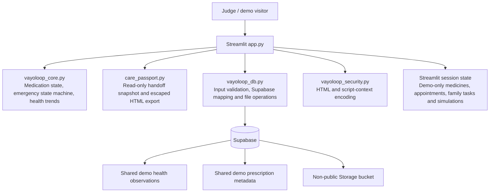

# VayoLoop architecture

VayoLoop is a small, modular hackathon prototype. The Streamlit application is the primary deployment; the static HTML/JavaScript experience is retained as a legacy interactive preview.

## Runtime shape

## Responsibility boundaries

| Module | Responsibility | Key boundary |
|---|---|---|
| `app.py` | Streamlit pages, forms, navigation and session orchestration | UI only; clinical decisions are not made here |
| `vayoloop_core.py` | Pure medication-status, event-transition and health-trend logic | Health trends are numerical descriptions, not clinical interpretations |
| `vayoloop_db.py` | Supabase client, record mapping, validation, wearable CSV parsing and bulk health import, prescription upload/download/delete | Publishable key only; fixed demo workspace; strict file-object paths; full batch validation before insert |
| `vayoloop_security.py` | Escaping for HTML fragments and JSON placed inside scripts | Untrusted values must be encoded for their output context |
| `care_passport.py` | Read-only snapshot, print-ready export and handoff data audit | Escaped output; administrative and temporal consistency only, never a clinical assessment |
| `tests/` | Domain, persistence mapping, export, security and page-render regression tests | No real patient data or external device is needed in CI |

## Data and persistence

| Data | Storage | Demo behaviour |
|---|---|---|
| Health observations | Supabase table with RLS | Persists in one shared public demo workspace |
| Prescription metadata | Supabase table with RLS | Persists in one shared public demo workspace |
| Original prescription files | Non-public Supabase Storage bucket with object policies | App-mediated access; still shared with anonymous demo visitors |
| Medicines and dose reports | Streamlit session state | Resets with the session |
| Appointments, tasks and check-ins | Streamlit session state | Resets with the session |
| Connected-device and emergency flows | Streamlit session state | Simulations only; no real device or contact is reached |

## Validation and safety

- Health observations are checked for a non-empty metric, finite non-negative numeric value, bounded unit/source text and a timezone-aware timestamp.
- Prescription uploads are limited to PDF/JPEG/PNG/WebP, size-capped, and checked against file signatures as well as the declared type.
- Storage paths must match the fixed demo workspace and generated object-key format before download or deletion.
- Text from user-controlled fields is escaped before it is inserted into HTML or JavaScript contexts.
- Medication reports remain self-reported. The app never adjusts a prescription, recommends a dose or diagnoses a condition.
- Emergency events and wearable/home-sensor events are simulations. VayoLoop does not place calls or send notifications.

## Quality checks

Every push runs:
1. JavaScript syntax and UI-wiring smoke checks.
2. Python linting with Ruff.
3. Python compilation.
4. Unit and Streamlit page-render tests.
5. GitHub Pages publication of the legacy preview only after quality checks pass.

The Streamlit Community Cloud deployment is separate. A successful Pages deployment does not prove that the Streamlit demo is healthy; test the configured Streamlit URL independently.
