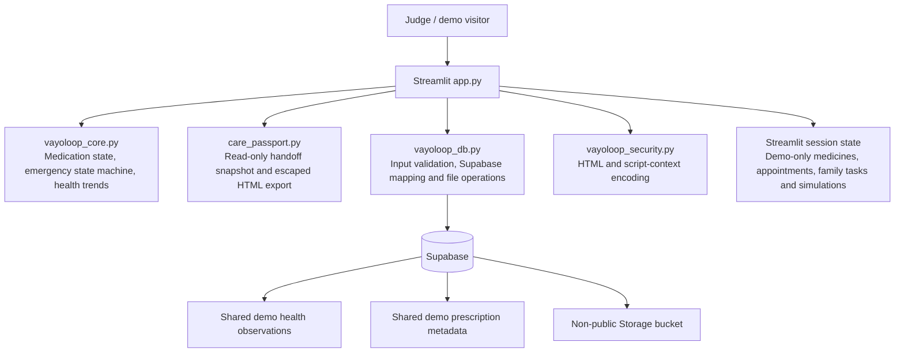
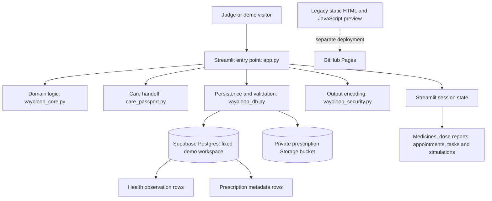
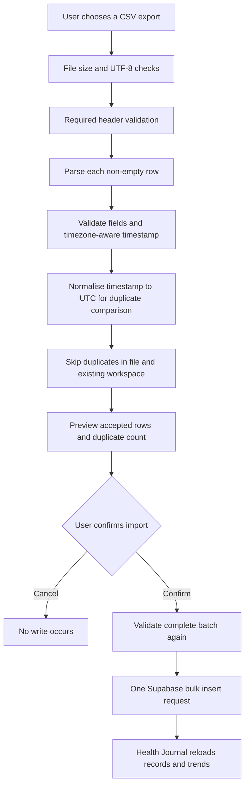

# VayoLoop architecture

VayoLoop is a small, modular hackathon prototype. The Streamlit application is the primary deployment; the static HTML/JavaScript experience is retained as a legacy interactive preview.

## Runtime shape

## Responsibility boundaries

| Module | Responsibility | Key boundary |
|---|---|---|
| `app.py` | Streamlit pages, forms, navigation and session orchestration | UI only; clinical decisions are not made here |
| `vayoloop_core.py` | Pure medication-status, event-transition and health-trend logic | Health trends are numerical descriptions, not clinical interpretations |
| `vayoloop_db.py` | Supabase client, record mapping, validation, wearable CSV parsing and bulk health import, prescription upload/download/delete | Publishable key only; fixed demo workspace; strict file-object paths; full batch validation before insert |
| `vayoloop_security.py` | Escaping for HTML fragments and JSON placed inside scripts | Untrusted values must be encoded for their output context |
| `care_passport.py` | Read-only snapshot, print-ready export and handoff data audit | Escaped output; administrative and temporal consistency only, never a clinical assessment |
| `tests/` | Domain, persistence mapping, export, security and page-render regression tests | No real patient data or external device is needed in CI |

## Data and persistence

| Data | Storage | Demo behaviour |
|---|---|---|
| Health observations | Supabase table with RLS | Persists in one shared public demo workspace |
| Prescription metadata | Supabase table with RLS | Persists in one shared public demo workspace |
| Original prescription files | Non-public Supabase Storage bucket with object policies | App-mediated access; still shared with anonymous demo visitors |
| Medicines and dose reports | Streamlit session state | Resets with the session |
| Appointments, tasks and check-ins | Streamlit session state | Resets with the session |
| Connected-device and emergency flows | Streamlit session state | Simulations only; no real device or contact is reached |

## Validation and safety

- Health observations are checked for a non-empty metric, finite non-negative numeric value, bounded unit/source text and a timezone-aware timestamp.
- Prescription uploads are limited to PDF/JPEG/PNG/WebP, size-capped, and checked against file signatures as well as the declared type.
- Storage paths must match the fixed demo workspace and generated object-key format before download or deletion.
- Text from user-controlled fields is escaped before it is inserted into HTML or JavaScript contexts.
- Medication reports remain self-reported. The app never adjusts a prescription, recommends a dose or diagnoses a condition.
- Emergency events and wearable/home-sensor events are simulations. VayoLoop does not place calls or send notifications.

## Quality checks

Every push runs:
1. JavaScript syntax and UI-wiring smoke checks.
2. Python linting with Ruff.
3. Python compilation.
4. Unit and Streamlit page-render tests.
5. GitHub Pages publication of the legacy preview only after quality checks pass.

The Streamlit Community Cloud deployment is separate. A successful Pages deployment does not prove that the Streamlit demo is healthy; test the configured Streamlit URL independently.

## Architecture and trust boundaries

### Component and responsibility map

The Streamlit application is the primary hackathon product. The older `index.html` and `app.js` preview is a separate GitHub Pages deployment; it is not the Streamlit runtime and does not share its Supabase persistence path.

| Boundary / module | Owns | Does not own | Evidence in repository |
|---|---|---|---|
| UI boundary | `app.py`: forms, navigation, previews, confirmation and session orchestration | Medical decisions, direct SQL policy or secret-key access | `connect_demo_database`, Health Journal and Care Passport sections |
| Domain boundary | `vayoloop_core.py`: medicine status, demo safety-event transitions and numerical trend summaries | Database calls, diagnosis or clinical reference-range assessment | `medication_state`, `analyse_health_trends` |
| Persistence boundary | `vayoloop_db.py`: validation, mapping, CSV parsing, batch insert and prescription file operations | UI rendering or user identity management | `parse_health_observations_csv`, `save_health_observations`, `save_prescription_record` |
| Export boundary | `care_passport.py`: read-only snapshot, administrative handoff review and escaped HTML output | Modifying the workspace or certifying a clinical record | `build_care_passport`, `analyse_handoff_completeness`, `render_care_passport_html` |
| Output-encoding boundary | `vayoloop_security.py`: context-specific HTML and script JSON encoding | Trusting user-controlled strings as markup or executable script | `html_text`, `json_for_script` |
| Legacy preview boundary | `index.html` and `app.js`: independent browser-only preview with local storage | Streamlit server state, Supabase writes or live device APIs | `scripts/smoke-check.mjs` checks its own DOM wiring |

### Wearable / health-app CSV import data flow

**CSV contract and limits**

| CSV column | Required | Validation / default |
|---|---|---|
| `metric` | Yes | Non-empty label; maximum 120 characters |
| `value` | Yes | Finite, non-negative numeric value; no clinical threshold is applied |
| `unit` | Yes | Maximum 32 characters |
| `observed_at` | Yes | ISO-8601 timestamp with an explicit timezone offset |
| `source` | No | Defaults to `Imported wearable CSV`; maximum 100 characters |

- Upload limit: 2 MB and 500 non-empty rows.
- UTF-8 and UTF-8-with-BOM are accepted. Missing columns, malformed values, non-finite numbers and timezone-naive timestamps are rejected.
- Duplicate fingerprint: case-insensitive metric and unit, numeric value, and observation instant normalised to UTC. Duplicates within the file and against the loaded workspace are skipped.
- The user sees a preview and must confirm before any write. In cloud mode, the validated list is sent in one batch insert; in offline/test mode, rows are added to the current Streamlit session only.
- The upload does not authenticate the originating device or prove that a reading came from a physical wearable.

### Data ownership and persistence boundary

| Data class | Current storage | Lifetime and visibility |
|---|---|---|
| Health observations | Supabase table with row-level security for one fixed demo workspace | Persists; shared with all visitors to the public demo |
| Prescription metadata | Supabase table with row-level security for one fixed demo workspace | Persists; shared with all visitors to the public demo |
| Original prescription files | Non-public Supabase Storage bucket with object-path policies | Persists; app-mediated downloads; shared-demo data, not private patient storage |
| Medicines, dose reports, appointments, tasks and check-ins | Streamlit session state | Session-scoped; may reset when the session ends |
| Connected-device status and emergency events | Streamlit session state | Simulated only; no physical device or contact is reached |

**Public-demo consequence:** the publishable key is intended for a public client and is constrained by RLS to the fixed fictional workspace. RLS is not per-person privacy in this no-login demo. Any visitor can view or change the shared persisted demo records. Use only fictional data; never upload real prescriptions or health records. No service-role key is embedded in the app.

### Security and failure boundaries

1. **Untrusted input:** user-entered fields and uploaded CSV rows are revalidated in Python before persistence. Client-side file type selection is not the security control.
2. **Prescription file handling:** uploads are limited to PDF/JPEG/PNG/WebP, capped at 10 MB, checked against file signatures and MIME declarations, and assigned generated object keys. Download/delete paths must match the fixed workspace object-key format.
3. **Batch import:** all rows are validated before the database insert is called. Duplicate detection is performed before confirmation. A failed insert is surfaced to the UI; it is not reported as a successful import.
4. **Output encoding:** user-controlled text is escaped for HTML and JSON embedded in scripts; exported Care Passport HTML escapes cell values.
5. **Clinical boundary:** dose reports are self-reported; numerical trends and completeness checks are administrative displays only. No diagnosis, prescription authenticity check, medicine-condition matching, dose recommendation or treatment change is performed.
6. **Device and emergency boundary:** CSV file import is user initiated and is not a Bluetooth/vendor-cloud integration. Device events, fall alerts, family notifications and SOS are simulations. The app does not dial 112 or dispatch help.
7. **Deployment boundary:** GitHub Pages publishes the legacy static preview after CI. Streamlit Community Cloud is a separate deployment and must be checked independently.

### Reproducible evidence

| Check | What it covers |
|---|---|
| `npm run check` | Legacy preview wiring, UI safety assertions, accessible contrast checks and presence of the Streamlit CSV import flow |
| `ruff check --output-format=github .` | Python lint rules, including bug-pattern checks such as loop-variable closure issues |
| `python -m compileall -q app.py vayoloop_core.py vayoloop_db.py vayoloop_security.py care_passport.py tests` | Python syntax compilation |
| `python -m unittest discover -s tests -v` | Domain logic, import validation/deduplication, batch-write validation, upload cleanup, security helpers, Care Passport and Streamlit section rendering |

Sample input: `examples/wearable_export_sample.csv`. The parser and persistence boundary are in `vayoloop_db.py`; the preview/confirmation UI is in the Health Journal section of `app.py`.
